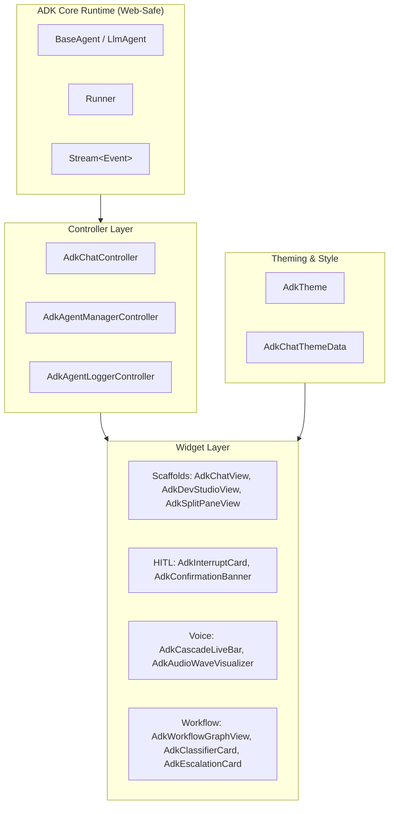

# Flutter ADK Widget Technical Specification

This document provides the exhaustive technical specification for the complete UI widget library in `flutter_adk`.

`flutter_adk` is the official Flutter UI Kit and facade for the Google Agent Development Kit (ADK) Dart runtime. It delivers production-grade, Material 3-compliant, accessible, and 100% Web (WASM / dart2wasm)-compatible widgets and controllers.

---

## Table of Contents

1. [Architectural Overview & Design Principles](#1-architectural-overview--design-principles)
2. [Scaffolds & Integrated Views](#2-scaffolds--integrated-views)
   - [AdkChatView](#adkchatview)
   - [AdkDevStudioView](#adkdevstudioview)
   - [AdkSplitPaneView](#adksplitpaneview)
   - [AdkAgentManagementView](#adkagentmanagementview)
   - [AdkSmartFormView](#adksmartformview)
   - [AdkAgentLoggerView](#adkagentloggerview)
   - [AdkToolInspectorView](#adktoolinspectorview)
   - [AdkArtifactViewer & AdkArtifactCard](#adkartifactviewer--adkartifactcard)
3. [Modals, Drawers & Action Triggers](#3-modals-drawers--action-triggers)
   - [showAdkChatBottomSheet](#showadkchatbottomsheet)
   - [AdkFloatingChatButton](#adkfloatingchatbutton)
   - [AdkSessionDrawer](#adksessiondrawer)
4. [Chat Feed & Message Components](#4-chat-feed--message-components)
   - [AdkMessageBubble](#adkmessagebubble)
   - [AdkTypingIndicator](#adktypingindicator)
   - [AdkReasoningExpander](#adkreasoningexpander)
   - [AdkPromptSuggestionsBar](#adkpromptsuggestionsbar)
   - [AdkInlineAssistantBar](#adkinlineassistantbar)
5. [Tool Execution, Code & Grounding](#5-tool-execution-code--grounding)
   - [AdkToolCallCard](#adktoolcallcard)
   - [AdkCodeExecutionCard](#adkcodeexecutioncard)
   - [AdkGroundingSourcesBar](#adkgroundingsourcesbar)
   - [AdkStructuredDataView](#adkstructureddataview)
6. [Human-in-the-Loop & Execution Interrupts](#6-human-in-the-loop--execution-interrupts)
   - [AdkConfirmationBanner & AdkConfirmationDialog](#adkconfirmationbanner--adkconfirmationdialog)
   - [AdkHumanInTheLoopCard](#adkhumanintheloopcard)
   - [AdkInterruptBanner](#adkinterruptbanner)
   - [AdkInterruptCard](#adkinterruptcard)
7. [Real-Time Multimodal & Voice Streaming](#7-real-time-multimodal--voice-streaming)
   - [AdkCascadeLiveBar](#adkcascadelivebar)
   - [AdkLiveBargeInIndicator](#adklivebargeinindicator)
   - [AdkVoiceMicButton](#adkvoicemicbutton)
   - [AdkAudioWaveVisualizer](#adkaudiowavevisualizer)
8. [Workflow, Routing & Multi-Model Visualization](#8-workflow-routing--multi-model-visualization)
   - [AdkWorkflowGraphView](#adkworkflowgraphview)
   - [AdkWorkflowProgressIndicator](#adkworkflowprogressindicator)
   - [AdkClassifierCard](#adkclassifiercard)
   - [AdkModelConsultBadge](#adkmodelconsultbadge)
   - [AdkEscalationCard](#adkescalationcard)
   - [AdkAgentHierarchyBadge](#adkagenthierarchybadge)
   - [AdkAgentPersonaSelector](#adkagentpersonaselector)
9. [Telemetry & Reactive Builders](#9-telemetry--reactive-builders)
   - [AdkTokenUsageBadge](#adktokenusagebadge)
   - [AdkEventStreamBuilder](#adkeventstreambuilder)
10. [ADK UI Utilities](#10-adk-ui-utilities)
11. [Theming System (AdkTheme & AdkChatThemeData)](#11-theming-system-adktheme--adkchatthemedata)

---

## 1. Architectural Overview & Design Principles

### Core Pillars
1. **Turnkey Simplicity**: Drop-in widgets require minimal setup (e.g. `AdkChatView(agent: myAgent)`).
2. **Deep Customizability**: Every widget exposes granular styling properties (colors, border radii, elevations, margins, paddings) and builder callbacks to completely replace or augment child components.
3. **Reactive State & Streaming**: Direct integration with ADK's `Stream<Event>` pipelines and `AdkChatController`.
4. **Platform & WASM Compliance**: Pure Dart implementation in core logic; 100% Flutter Web (WASM) safe with no native `dart:io` restrictions in UI widgets.
5. **Accessibility & Semantics**: Standard Material 3 semantics, high-contrast label fallbacks, and screen reader-friendly roles.



---

## 2. Scaffolds & Integrated Views

### `AdkChatView`

Primary conversational chat interface supporting message streaming, reasoning steps, tool cards, attachment uploads, voice input triggers, and suggestion chips.

- **Class**: `StatefulWidget`
- **File**: [`adk_chat_view.dart`](file:///Users/jaichang/Documents/GitHub/adk-labs/adk-dart/adk_dart/packages/flutter_adk/lib/src/widgets/adk_chat_view.dart)

#### Parameters Specification

| Parameter | Type | Required | Default | Description |
| :--- | :--- | :---: | :--- | :--- |
| `controller` | `AdkChatController?` | Optional | `null` | Pre-existing chat controller. If omitted, created automatically from `agent` or `runner`. |
| `agent` | `BaseAgent?` | Optional | `null` | Agent instance to run when `controller` is omitted. |
| `runner` | `Runner?` | Optional | `null` | Runner instance to run when `controller` is omitted. |
| `theme` | `AdkChatThemeData?` | Optional | `null` | Theme configuration overriding ancestor `AdkTheme`. |
| `title` | `String` | Optional | `'AI Assistant'` | Header title when `showAppBar` is true. |
| `inputPlaceholder` | `String` | Optional | `'Ask something...'` | Hint text inside the input field. |
| `suggestions` | `List<String>?` | Optional | `null` | Prompt suggestion chips displayed above the input bar. |
| `emptyStateWidget` | `Widget?` | Optional | `null` | Static widget displayed when message history is empty. |
| `emptyStateBuilder` | `Widget Function(BuildContext)?` | Optional | `null` | Dynamic builder for empty state screen. |
| `messageBubbleBuilder` | `Widget Function(BuildContext, AdkChatMessage)?` | Optional | `null` | Custom builder to completely replace message bubbles. |
| `avatarBuilder` | `Widget Function(BuildContext, AdkChatMessage)?` | Optional | `null` | Custom avatar widget builder for messages. |
| `inputBarBuilder` | `Widget Function(BuildContext, TextEditingController, VoidCallback, bool)?` | Optional | `null` | Custom builder replacing the default input bar. |
| `suggestionBuilder` | `Widget Function(BuildContext, String, VoidCallback)?` | Optional | `null` | Custom builder for individual suggestion chips. |
| `typingIndicatorBuilder` | `Widget Function(BuildContext)?` | Optional | `null` | Custom builder for the typing animation indicator. |
| `headerBuilder` | `Widget Function(BuildContext)?` | Optional | `null` | Custom widget placed above the scrollable message list. |
| `footerBuilder` | `Widget Function(BuildContext)?` | Optional | `null` | Custom widget placed between the message list and input bar. |
| `onVoicePressed` | `VoidCallback?` | Optional | `null` | Callback triggered when the voice microphone button is tapped. |
| `onTapMessage` | `void Function(AdkChatMessage)?` | Optional | `null` | Tap callback for an individual message bubble. |
| `onLongPressMessage`| `void Function(AdkChatMessage)?`| Optional | `null` | Long-press callback for an individual message bubble. |
| `showAppBar` | `bool` | Optional | `false` | Whether to display an integrated Material `AppBar`. |
| `showAvatars` | `bool?` | Optional | `null` | Explicit toggle to show/hide avatars (inherits from theme if null). |

---

### `AdkDevStudioView`

Complete developer studio view replicating `adk web` capabilities inside Flutter, providing 4 interactive tabs:
1. **Playground**: Live chat session with runtime model execution.
2. **Logger**: Real-time agent I/O, telemetry, latency, and token metrics with JSON export.
3. **Agent Graph**: Sub-agent and tools dependency tree viewer.
4. **State**: Live session state variable inspector.

- **Class**: `StatefulWidget`
- **File**: [`adk_dev_studio_view.dart`](file:///Users/jaichang/Documents/GitHub/adk-labs/adk-dart/adk_dart/packages/flutter_adk/lib/src/widgets/adk_dev_studio_view.dart)

#### Parameters Specification

| Parameter | Type | Required | Default | Description |
| :--- | :--- | :---: | :--- | :--- |
| `agent` | `BaseAgent?` | Optional | `null` | Primary agent under inspection. |
| `runner` | `Runner?` | Optional | `null` | Underlying runtime execution runner. |
| `controller` | `AdkChatController?` | Optional | `null` | Shared chat controller instance. |
| `title` | `String` | Optional | `'ADK Dev Studio'` | AppBar title. |
| `initialTabIndex` | `int` | Optional | `0` | Default active tab index (0..3). |
| `initialState` | `Map<String, dynamic>`| Optional | `{}` | Initial state variables passed to the State Inspector. |
| `suggestions` | `List<String>` | Optional | 3 prebuilt prompts | Quick-test suggestions shown in the Playground tab. |

---

### `AdkSplitPaneView`

An adaptive multi-pane layout designed for Web, Desktop, and Tablet form factors. Displays the conversational chat on the left pane and tools/logs/state in tabs on the right pane. Automatically collapses into single-pane mode on mobile screens smaller than `breakpoint`.

- **Class**: `StatefulWidget`
- **File**: [`adk_split_pane_view.dart`](file:///Users/jaichang/Documents/GitHub/adk-labs/adk-dart/adk_dart/packages/flutter_adk/lib/src/widgets/adk_split_pane_view.dart)

#### Parameters Specification

| Parameter | Type | Required | Default | Description |
| :--- | :--- | :---: | :--- | :--- |
| `agent` | `BaseAgent?` | Optional | `null` | Agent to execute. |
| `runner` | `Runner?` | Optional | `null` | Runner instance. |
| `controller` | `AdkChatController?` | Optional | `null` | Active chat controller. |
| `theme` | `AdkChatThemeData?` | Optional | `null` | Theme styling. |
| `splitRatio` | `double` | Optional | `0.55` | Left pane width ratio (between 0.1 and 0.9). |
| `breakpoint` | `double` | Optional | `768.0` | Screen width below which the layout collapses. |
| `dividerColor` | `Color?` | Optional | Theme outline | Color of the vertical dividing border. |
| `dividerWidth` | `double` | Optional | `1.0` | Thickness of the divider line. |
| `showToolInspector`| `bool` | Optional | `true` | Whether to include the Tool Inspector tab. |
| `showLogger` | `bool` | Optional | `true` | Whether to include the Live Logger tab. |
| `customRightTabs` | `List<Tab>` | Optional | `const []` | Additional user-defined tabs on the right pane. |
| `customRightViews`| `List<Widget>` | Optional | `const []` | Matching widget views for `customRightTabs`. |
| `leftPaneBuilder` | `Widget Function(BuildContext)?` | Optional | `null` | Custom builder to override the left pane. |
| `rightPaneBuilder`| `Widget Function(BuildContext)?` | Optional | `null` | Custom builder to override the right pane. |

---

### `AdkAgentManagementView`

Administrative fleet management dashboard for observing, toggling on/off, searching, and configuring multi-agent systems.

- **Class**: `StatefulWidget`
- **File**: [`adk_agent_management_view.dart`](file:///Users/jaichang/Documents/GitHub/adk-labs/adk-dart/adk_dart/packages/flutter_adk/lib/src/widgets/adk_agent_management_view.dart)

#### Parameters Specification

| Parameter | Type | Required | Default | Description |
| :--- | :--- | :---: | :--- | :--- |
| `controller` | `AdkAgentManagerController` | **Required** | - | Fleet manager controller. |
| `onAgentSelected` | `ValueChanged<AdkAgentMetadata>?` | Optional | `null` | Callback when an agent card is clicked. |
| `theme` | `AdkChatThemeData?` | Optional | `null` | Theme overrides. |
| `title` | `String` | Optional | `'AI Agent Fleet Manager'` | Header title. |
| `showMetricsHeader`| `bool` | Optional | `true` | Shows total agents, active agents, and avg latency cards. |
| `agentCardBuilder`| `Widget Function(BuildContext, AdkAgentMetadata, ValueChanged<bool>, VoidCallback)?` | Optional | `null` | Custom builder for individual agent cards. |
| `headerBuilder` | `Widget Function(BuildContext)?` | Optional | `null` | Custom header builder. |
| `emptyStateBuilder`| `Widget Function(BuildContext)?` | Optional | `null` | Custom empty state builder. |

---

### `AdkSmartFormView`

Conversational form view that uses an AI agent to interview the user and automatically populate structured form fields through dialogue.

- **Class**: `StatefulWidget`
- **File**: [`adk_smart_form_view.dart`](file:///Users/jaichang/Documents/GitHub/adk-labs/adk-dart/adk_dart/packages/flutter_adk/lib/src/widgets/adk_smart_form_view.dart)

#### Parameters Specification

| Parameter | Type | Required | Default | Description |
| :--- | :--- | :---: | :--- | :--- |
| `agent` | `BaseAgent` | **Required** | - | Form-filling agent. |
| `fields` | `List<AdkFormField>` | **Required** | - | Field definitions (keys, labels, types, required flags). |
| `onSubmit` | `ValueChanged<Map<String, dynamic>>` | **Required** | - | Callback when form data is finalized and submitted. |
| `title` | `String` | Optional | `'Conversational Form'` | Title of the form view. |
| `theme` | `AdkChatThemeData?` | Optional | `null` | Theme overrides. |

---

### `AdkAgentLoggerView`

Real-time telemetry and I/O log inspector. Filters entries by category (`all`, `prompt`, `response`, `toolCall`, `error`, `system`), supports free-text search, and provides 1-click JSON export and clipboard copy.

- **Class**: `StatefulWidget`
- **File**: [`adk_agent_logger_view.dart`](file:///Users/jaichang/Documents/GitHub/adk-labs/adk-dart/adk_dart/packages/flutter_adk/lib/src/widgets/adk_agent_logger_view.dart)

#### Parameters Specification

| Parameter | Type | Required | Default | Description |
| :--- | :--- | :---: | :--- | :--- |
| `controller` | `AdkAgentLoggerController` | **Required** | - | Logger controller buffering events. |
| `showFilterChips` | `bool` | Optional | `true` | Whether to display category filter chips. |
| `showSearchBar` | `bool` | Optional | `true` | Whether to show the search text field. |
| `maxHeight` | `double?` | Optional | `null` | Constrained height for embedded use. |

---

### `AdkToolInspectorView`

Visual tree inspector displaying all declared tools registered on an agent, including their parameter schemas, types, required properties, and descriptions.

- **Class**: `StatelessWidget`
- **File**: [`adk_tool_inspector_view.dart`](file:///Users/jaichang/Documents/GitHub/adk-labs/adk-dart/adk_dart/packages/flutter_adk/lib/src/widgets/adk_tool_inspector_view.dart)

#### Parameters Specification

| Parameter | Type | Required | Default | Description |
| :--- | :--- | :---: | :--- | :--- |
| `agent` | `BaseAgent` | **Required** | - | Agent whose tools will be inspected. |
| `title` | `String` | Optional | `'Registered Tools'` | Header title. |

---

### `AdkArtifactViewer` & `AdkArtifactCard`

Widgets for viewing, inspecting, copying, and rendering artifacts (markdown, code, text, HTML, and binary references) produced by agents or retrieved via `LoadArtifactsTool`.

- **Class**: `StatelessWidget`
- **File**: [`adk_artifact_viewer.dart`](file:///Users/jaichang/Documents/GitHub/adk-labs/adk-dart/adk_dart/packages/flutter_adk/lib/src/widgets/adk_artifact_viewer.dart)

#### Parameters Specification (`AdkArtifactViewer`)

| Parameter | Type | Required | Default | Description |
| :--- | :--- | :---: | :--- | :--- |
| `filename` | `String` | **Required** | - | Artifact filename or key. |
| `content` | `String` | **Required** | - | Artifact payload content string. |
| `mimeType` | `String?` | Optional | `null` | MIME type (e.g. `'text/markdown'`, `'application/json'`). |
| `version` | `int?` | Optional | `null` | Artifact revision number. |
| `onCopy` | `VoidCallback?` | Optional | `null` | Custom copy callback. |

---

## 3. Modals, Drawers & Action Triggers

### `showAdkChatBottomSheet`

Opens an interactive, modal draggable bottom sheet hosting an `AdkChatView`. Ideal for conversational help or assistant drawers within an existing mobile app.

```dart
Future<void> showAdkChatBottomSheet({
  required BuildContext context,
  required BaseAgent agent,
  String title = 'AI Assistant',
  double initialChildSize = 0.85,
  double minChildSize = 0.4,
  double maxChildSize = 0.95,
  AdkChatThemeData? theme,
})
```

---

### `AdkFloatingChatButton`

A Floating Action Button (FAB) that opens an `AdkChatView` modal bottom sheet when tapped.

- **Class**: `StatelessWidget`
- **File**: [`adk_floating_chat_button.dart`](file:///Users/jaichang/Documents/GitHub/adk-labs/adk-dart/adk_dart/packages/flutter_adk/lib/src/widgets/adk_floating_chat_button.dart)

#### Parameters Specification

| Parameter | Type | Required | Default | Description |
| :--- | :--- | :---: | :--- | :--- |
| `agent` | `BaseAgent` | **Required** | - | Agent instance invoked when opened. |
| `icon` | `IconData` | Optional | `Icons.auto_awesome` | Button icon. |
| `tooltip` | `String` | Optional | `'Chat with AI'` | Accessibility tooltip. |
| `backgroundColor` | `Color?` | Optional | Theme primary | Button background color. |

---

### `AdkSessionDrawer`

A sidebar navigation drawer for managing conversation sessions (listing, switching, creating new conversations via `+`, and deleting sessions).

- **Class**: `StatelessWidget`
- **File**: [`adk_session_drawer.dart`](file:///Users/jaichang/Documents/GitHub/adk-labs/adk-dart/adk_dart/packages/flutter_adk/lib/src/widgets/adk_session_drawer.dart)

#### Parameters Specification

| Parameter | Type | Required | Default | Description |
| :--- | :--- | :---: | :--- | :--- |
| `sessions` | `List<AdkSessionInfo>` | **Required** | - | List of available session summaries. |
| `activeSessionId` | `String?` | Optional | `null` | Currently selected session ID. |
| `onSessionSelected`| `ValueChanged<String>` | **Required** | - | Callback when a session is chosen. |
| `onNewSession` | `VoidCallback?` | Optional | `null` | Callback when `+ New Chat` is tapped. |
| `onDeleteSession` | `ValueChanged<String>?`| Optional | `null` | Callback when a session is deleted. |

---

## 4. Chat Feed & Message Components

### `AdkMessageBubble`

Renders an individual chat message turn. Supports `user`, `model`, `tool`, `system`, and `error` roles, markdown text formatting, code execution cards, grounding sources, tool call expansions, thinking accordions, and copy actions.

- **Class**: `StatelessWidget`
- **File**: [`adk_message_bubble.dart`](file:///Users/jaichang/Documents/GitHub/adk-labs/adk-dart/adk_dart/packages/flutter_adk/lib/src/widgets/adk_message_bubble.dart)

#### Parameters Specification

| Parameter | Type | Required | Default | Description |
| :--- | :--- | :---: | :--- | :--- |
| `message` | `AdkChatMessage` | **Required** | - | Immutable chat message model. |
| `theme` | `AdkChatThemeData?` | Optional | `null` | Theme styling. |
| `avatar` | `Widget?` | Optional | `null` | User or agent avatar override. |
| `onTap` | `VoidCallback?` | Optional | `null` | Tap callback. |
| `onLongPress` | `VoidCallback?` | Optional | `null` | Long-press callback. |
| `showAvatar` | `bool` | Optional | `true` | Whether to display the avatar. |

---

### `AdkTypingIndicator`

Pulsing three-dot animation displayed while the agent is generating a response.

- **Class**: `StatefulWidget`
- **File**: [`adk_typing_indicator.dart`](file:///Users/jaichang/Documents/GitHub/adk-labs/adk-dart/adk_dart/packages/flutter_adk/lib/src/widgets/adk_typing_indicator.dart)

#### Parameters Specification

| Parameter | Type | Required | Default | Description |
| :--- | :--- | :---: | :--- | :--- |
| `dotColor` | `Color?` | Optional | Theme outline | Color of the pulsing dots. |
| `dotSize` | `double` | Optional | `8.0` | Diameter of each dot. |

---

### `AdkReasoningExpander`

Collapsible accordion widget for inspecting extended thinking and internal reasoning tokens produced by reasoning models (e.g. Gemini 3.7 Thinking, Claude 3.7 Sonnet).

- **Class**: `StatefulWidget`
- **File**: [`adk_reasoning_expander.dart`](file:///Users/jaichang/Documents/GitHub/adk-labs/adk-dart/adk_dart/packages/flutter_adk/lib/src/widgets/adk_reasoning_expander.dart)

#### Parameters Specification

| Parameter | Type | Required | Default | Description |
| :--- | :--- | :---: | :--- | :--- |
| `thought` | `String` | **Required** | - | Raw reasoning / thinking text. |
| `durationMs` | `int?` | Optional | `null` | Thinking duration in milliseconds (e.g. `Thought for 2.4s`). |
| `initiallyExpanded`| `bool` | Optional | `false` | Whether initially expanded. |

---

### `AdkPromptSuggestionsBar`

Horizontally scrollable bar of suggestion chips for quick one-tap prompts.

- **Class**: `StatelessWidget`
- **File**: [`adk_prompt_suggestions_bar.dart`](file:///Users/jaichang/Documents/GitHub/adk-labs/adk-dart/adk_dart/packages/flutter_adk/lib/src/widgets/adk_prompt_suggestions_bar.dart)

#### Parameters Specification

| Parameter | Type | Required | Default | Description |
| :--- | :--- | :---: | :--- | :--- |
| `suggestions` | `List<String>` | **Required** | - | List of prompt strings. |
| `onSelected` | `ValueChanged<String>` | **Required** | - | Callback when a prompt is tapped. |
| `chipBuilder` | `Widget Function(BuildContext, String, VoidCallback)?` | Optional | `null` | Custom builder for individual chips. |

---

### `AdkInlineAssistantBar`

Copilot-style inline toolbar designed to attach above a `TextFormField` or `TextField` providing one-click AI operations: `Fix Grammar`, `Polish`, `Summarize`, and `Translate`.

- **Class**: `StatelessWidget`
- **File**: [`adk_inline_assistant_bar.dart`](file:///Users/jaichang/Documents/GitHub/adk-labs/adk-dart/adk_dart/packages/flutter_adk/lib/src/widgets/adk_inline_assistant_bar.dart)

#### Parameters Specification

| Parameter | Type | Required | Default | Description |
| :--- | :--- | :---: | :--- | :--- |
| `agent` | `BaseAgent` | **Required** | - | Assistant agent performing transformations. |
| `targetController` | `TextEditingController` | **Required** | - | Target text field controller being edited. |

---

## 5. Tool Execution, Code & Grounding

### `AdkToolCallCard`

Interactive card displaying tool execution turns, input arguments JSON, execution status, and return values.

- **Class**: `StatefulWidget`
- **File**: [`adk_tool_call_card.dart`](file:///Users/jaichang/Documents/GitHub/adk-labs/adk-dart/adk_dart/packages/flutter_adk/lib/src/widgets/adk_tool_call_card.dart)

#### Parameters Specification

| Parameter | Type | Required | Default | Description |
| :--- | :--- | :---: | :--- | :--- |
| `toolName` | `String` | **Required** | - | Name of the executed tool. |
| `callId` | `String?` | Optional | `null` | Unique tool call ID. |
| `arguments` | `Map<String, dynamic>`| Optional | `{}` | Parameter arguments map. |
| `result` | `dynamic` | Optional | `null` | Return value from tool execution. |
| `status` | `AdkToolStatus` | Optional | `.success` | Execution state (`pending`, `running`, `success`, `error`). |
| `durationMs` | `int?` | Optional | `null` | Execution duration in milliseconds. |

---

### `AdkCodeExecutionCard`

Card displaying generated Python or shell code executed in sandboxes, displaying code with syntax background, execution outcomes, and stdout/stderr output panels.

- **Class**: `StatefulWidget`
- **File**: [`adk_code_execution_card.dart`](file:///Users/jaichang/Documents/GitHub/adk-labs/adk-dart/adk_dart/packages/flutter_adk/lib/src/widgets/adk_code_execution_card.dart)

#### Parameters Specification

| Parameter | Type | Required | Default | Description |
| :--- | :--- | :---: | :--- | :--- |
| `execution` | `AdkCodeExecution` | **Required** | - | Language, code snippet, output, and outcome. |
| `initiallyExpanded`| `bool` | Optional | `true` | Whether code & output panels start open. |

---

### `AdkGroundingSourcesBar`

Displays search queries and web/document sources cited by grounded models (Google Search Grounding, Vertex Search).

- **Class**: `StatelessWidget`
- **File**: [`adk_grounding_sources_bar.dart`](file:///Users/jaichang/Documents/GitHub/adk-labs/adk-dart/adk_dart/packages/flutter_adk/lib/src/widgets/adk_grounding_sources_bar.dart)

#### Parameters Specification

| Parameter | Type | Required | Default | Description |
| :--- | :--- | :---: | :--- | :--- |
| `grounding` | `AdkGroundingInfo` | **Required** | - | Search queries and citation sources. |
| `onSourceTap` | `void Function(AdkGroundingSource)?` | Optional | `null` | Tap callback for citation chips. |

---

### `AdkStructuredDataView`

Formatted tree and JSON viewer for structured outputs produced by agents (`outputSchema` / Gemini Structured Outputs).

- **Class**: `StatelessWidget`
- **File**: [`adk_structured_data_view.dart`](file:///Users/jaichang/Documents/GitHub/adk-labs/adk-dart/adk_dart/packages/flutter_adk/lib/src/widgets/adk_structured_data_view.dart)

#### Parameters Specification

| Parameter | Type | Required | Default | Description |
| :--- | :--- | :---: | :--- | :--- |
| `data` | `Object?` | **Required** | - | Map, List, or JSON string to render. |
| `title` | `String` | Optional | `'Structured Output'` | Header title. |
| `onCopy` | `VoidCallback?` | Optional | `null` | Copy callback. |

---

## 6. Human-in-the-Loop & Execution Interrupts

### `AdkConfirmationBanner` & `AdkConfirmationDialog`

Inline banner and modal alert dialog (`showAsDialog`) for requesting user permission before executing sensitive or dangerous actions.

- **Class**: `StatelessWidget`
- **File**: [`adk_confirmation_dialog.dart`](file:///Users/jaichang/Documents/GitHub/adk-labs/adk-dart/adk_dart/packages/flutter_adk/lib/src/widgets/adk_confirmation_dialog.dart)

#### Parameters Specification (`AdkConfirmationBanner`)

| Parameter | Type | Required | Default | Description |
| :--- | :--- | :---: | :--- | :--- |
| `title` | `String` | **Required** | - | Prompt title. |
| `description` | `String` | **Required** | - | Detailed description of the requested action. |
| `onConfirm` | `VoidCallback` | **Required** | - | Approval callback. |
| `onDeny` | `VoidCallback` | **Required** | - | Denial callback. |
| `confirmLabel` | `String` | Optional | `'Allow'` | Confirmation button label. |
| `denyLabel` | `String` | Optional | `'Deny'` | Denial button label. |
| `toolName` | `String?` | Optional | `null` | Tool name requesting authorization. |

---

### `AdkHumanInTheLoopCard`

Interactive card embedded directly in the chat stream when an agent triggers a HITL checkpoint. Supports `Approve`, `Reject`, and `Modify` actions.

- **Class**: `StatelessWidget`
- **File**: [`adk_human_in_the_loop_card.dart`](file:///Users/jaichang/Documents/GitHub/adk-labs/adk-dart/adk_dart/packages/flutter_adk/lib/src/widgets/adk_human_in_the_loop_card.dart)

#### Parameters Specification

| Parameter | Type | Required | Default | Description |
| :--- | :--- | :---: | :--- | :--- |
| `toolName` | `String` | **Required** | - | Target tool name. |
| `actionDescription`| `String?` | Optional | `null` | Description of the action. |
| `arguments` | `Map<String, dynamic>?` | Optional | `null` | Tool call arguments. |
| `onApprove` | `VoidCallback?` | Optional | `null` | Approve callback. |
| `onReject` | `VoidCallback?` | Optional | `null` | Reject callback. |
| `onModify` | `VoidCallback?` | Optional | `null` | Modify callback. |
| `isProcessing` | `bool` | Optional | `false` | Shows loading indicator when true. |
| `decision` | `String?` | Optional | `null` | Finalized decision state (`'approved'`, etc.). |
| `warningMessage`| `String?` | Optional | `null` | Security/risk warning message. |

---

### `AdkInterruptBanner`

Notification banner indicating that an execution pause is waiting for user input or approval.

- **Class**: `StatelessWidget`
- **File**: [`adk_interrupt_widgets.dart`](file:///Users/jaichang/Documents/GitHub/adk-labs/adk-dart/adk_dart/packages/flutter_adk/lib/src/widgets/adk_interrupt_widgets.dart)

#### Parameters Specification

| Parameter | Type | Required | Default | Description |
| :--- | :--- | :---: | :--- | :--- |
| `toolName` | `String` | **Required** | - | Interrupted tool name. |
| `reason` | `String?` | Optional | `null` | Explanation for the pause. |
| `interruptId` | `String?` | Optional | `null` | Unique interrupt ID. |
| `onResume` | `VoidCallback?` | Optional | `null` | Action button callback. |
| `onDismiss` | `VoidCallback?` | Optional | `null` | Dismiss callback. |
| `actionLabel` | `String` | Optional | `'Review & Resume'` | Button text label. |
| `backgroundColor`| `Color?` | Optional | Theme errorContainer | Container background color. |
| `foregroundColor`| `Color?` | Optional | Theme onErrorContainer | Text and icon color. |
| `icon` | `IconData?` | Optional | `Icons.pause_circle_filled_rounded` | Leading icon. |
| `borderRadius` | `BorderRadius?`| Optional | `BorderRadius.circular(12.0)` | Corner border radius. |
| `padding` | `EdgeInsetsGeometry?`| Optional | `symmetric(h: 14, v: 10)` | Inner padding. |
| `margin` | `EdgeInsetsGeometry?`| Optional | `symmetric(h: 12, v: 6)` | Outer margin. |
| `actionBuilder` | `Widget Function(BuildContext, VoidCallback?)?` | Optional | `null` | Custom builder to replace action button. |

---

### `AdkInterruptCard`

Detailed interactive card displaying arguments JSON, optional user text input field, and Resume/Cancel buttons.

- **Class**: `StatefulWidget`
- **File**: [`adk_interrupt_widgets.dart`](file:///Users/jaichang/Documents/GitHub/adk-labs/adk-dart/adk_dart/packages/flutter_adk/lib/src/widgets/adk_interrupt_widgets.dart)

#### Parameters Specification

| Parameter | Type | Required | Default | Description |
| :--- | :--- | :---: | :--- | :--- |
| `toolName` | `String` | **Required** | - | Name of the paused tool. |
| `interruptId` | `String?` | Optional | `null` | Interrupt identifier. |
| `arguments` | `Map<String, dynamic>?` | Optional | `null` | Tool parameters map. |
| `reason` | `String?` | Optional | `null` | Reason prompt. |
| `requiresInput` | `bool` | Optional | `false` | Whether user text input is required. |
| `inputPlaceholder` | `String` | Optional | `'Enter required input...'` | Input hint text. |
| `isProcessing` | `bool` | Optional | `false` | Loading state toggle. |
| `onResume` | `void Function(String? inputValue)?` | Optional | `null` | Resume callback passing user input. |
| `onCancel` | `VoidCallback?` | Optional | `null` | Cancel callback. |
| `cardElevation` | `double` | Optional | `2.0` | Elevation shadow. |
| `borderRadius` | `BorderRadius?` | Optional | `BorderRadius.circular(14.0)` | Corner radius. |
| `accentColor` | `Color?` | Optional | Theme error color | Accent color for borders and icons. |
| `headerBuilder` | `Widget Function(BuildContext)?` | Optional | `null` | Custom builder for header row. |
| `actionsBuilder` | `Widget Function(BuildContext, void Function(String?)?, VoidCallback?, bool)?` | Optional | `null` | Custom builder for action buttons. |
| `inputDecoration`| `InputDecoration?` | Optional | `null` | Input field decoration override. |

---

## 7. Real-Time Multimodal & Voice Streaming

### `AdkCascadeLiveBar`

Docked speech interaction bar for `CascadeLive` and Gemini Live API streaming sessions. Displays live STT transcript, reactive audio waveform, and barge-in alerts.

- **Class**: `StatelessWidget`
- **File**: [`adk_cascade_live_bar.dart`](file:///Users/jaichang/Documents/GitHub/adk-labs/adk-dart/adk_dart/packages/flutter_adk/lib/src/widgets/adk_cascade_live_bar.dart)

#### Parameters Specification

| Parameter | Type | Required | Default | Description |
| :--- | :--- | :---: | :--- | :--- |
| `isListening` | `bool` | **Required** | - | Whether user mic is transmitting. |
| `isSpeaking` | `bool` | Optional | `false` | Whether model speech is playing. |
| `isBargeIn` | `bool` | Optional | `false` | Whether user speech interrupted playback. |
| `partialTranscript` | `String?` | Optional | `null` | Live transcription from STT. |
| `onMicToggle` | `VoidCallback?` | Optional | `null` | Mic button tap callback. |
| `onDisconnect` | `VoidCallback?` | Optional | `null` | End live session callback. |
| `statusText` | `String?` | Optional | `null` | Overrides default status text. |
| `backgroundColor` | `Color?` | Optional | Theme surfaceContainerHigh | Container background color. |
| `visualizerColor` | `Color?` | Optional | Theme primary / secondary | Wave visualizer bars color. |
| `bargeInColor` | `Color?` | Optional | Theme error | Color applied during barge-in. |
| `elevation` | `double?` | Optional | `10.0` | Shadow elevation blur radius. |
| `margin` | `EdgeInsetsGeometry?`| Optional | `EdgeInsets.all(12.0)` | Outer margin. |
| `padding` | `EdgeInsetsGeometry?`| Optional | `symmetric(h: 16, v: 10)` | Inner padding. |
| `borderRadius` | `BorderRadius?`| Optional | `BorderRadius.circular(28.0)` | Corner border radius. |
| `customLeading` | `Widget?` | Optional | `null` | Custom widget replacing mic button. |
| `customTrailing` | `Widget?` | Optional | `null` | Custom widget replacing disconnect button. |
| `waveVisualizerBuilder`| `Widget Function(BuildContext, bool, bool, bool)?`| Optional | `null` | Custom waveform visualizer builder. |

---

### `AdkLiveBargeInIndicator`

Animated badge smoothly fading in when the user speaks while the model is talking.

- **Class**: `StatefulWidget`
- **File**: [`adk_cascade_live_bar.dart`](file:///Users/jaichang/Documents/GitHub/adk-labs/adk-dart/adk_dart/packages/flutter_adk/lib/src/widgets/adk_cascade_live_bar.dart)

#### Parameters Specification

| Parameter | Type | Required | Default | Description |
| :--- | :--- | :---: | :--- | :--- |
| `isBargeIn` | `bool` | **Required** | - | Whether barge-in is currently active. |
| `label` | `String` | Optional | `'Agent Interrupted'` | Badge text. |
| `backgroundColor` | `Color?` | Optional | Theme errorContainer | Badge background color. |
| `textColor` | `Color?` | Optional | Theme onErrorContainer | Text color. |
| `iconColor` | `Color?` | Optional | Theme error | Lightning bolt icon color. |
| `icon` | `IconData?` | Optional | `Icons.bolt_rounded` | Badge icon. |
| `borderRadius` | `BorderRadius?`| Optional | `BorderRadius.circular(16.0)` | Border radius. |
| `padding` | `EdgeInsetsGeometry?`| Optional | `symmetric(h: 10, v: 4)` | Padding. |

---

### `AdkVoiceMicButton` & `AdkAudioWaveVisualizer`

- **`AdkVoiceMicButton`**: Interactive microphone toggle button with pulsing ring when active.
- **`AdkAudioWaveVisualizer`**: Multi-bar audio waveform animation responding to speech decibels and activity states.

---

## 8. Workflow, Routing & Multi-Model Visualization

### `AdkWorkflowGraphView`

Flowchart and Directed Acyclic Graph (DAG) viewer for ADK `Workflow` pipelines. Supports both horizontal and vertical layouts, branch labels, status colors, and custom node/edge builders.

- **Class**: `StatelessWidget`
- **File**: [`adk_workflow_graph_view.dart`](file:///Users/jaichang/Documents/GitHub/adk-labs/adk-dart/adk_dart/packages/flutter_adk/lib/src/widgets/adk_workflow_graph_view.dart)

#### Parameters Specification

| Parameter | Type | Required | Default | Description |
| :--- | :--- | :---: | :--- | :--- |
| `nodes` | `List<AdkGraphNode>` | **Required** | - | Nodes in execution order. |
| `edges` | `List<AdkGraphEdge>` | Optional | `const []` | Directed edges linking nodes. |
| `onNodeTap` | `void Function(AdkGraphNode)?` | Optional | `null` | Tap callback for a node card. |
| `activeNodeId` | `String?` | Optional | `null` | ID of the active node to highlight. |
| `title` | `String` | Optional | `'Workflow Execution Graph'` | Header title. |
| `orientation` | `Axis` | Optional | `Axis.horizontal` | Layout direction (`horizontal` or `vertical`). |
| `nodeWidth` | `double` | Optional | `140.0` | Fixed width for default node cards. |
| `nodeHeight` | `double?` | Optional | `null` | Optional fixed height for default node cards. |
| `cardElevation` | `double` | Optional | `2.0` | Card elevation shadow. |
| `borderRadius` | `BorderRadius?` | Optional | `BorderRadius.circular(16.0)` | Corner border radius. |
| `cardMargin` | `EdgeInsetsGeometry?`| Optional | `symmetric(h: 12, v: 8)` | Outer margin. |
| `cardPadding` | `EdgeInsetsGeometry?`| Optional | `EdgeInsets.all(16.0)` | Inner padding. |
| `completedColor`| `Color?` | Optional | Green (`#388E3C`) | Color for completed nodes. |
| `runningColor` | `Color?` | Optional | Theme primary | Color for executing nodes. |
| `failedColor` | `Color?` | Optional | Theme error | Color for failed nodes. |
| `skippedColor` | `Color?` | Optional | Theme outline | Color for skipped nodes. |
| `pendingColor` | `Color?` | Optional | Theme outlineVariant | Color for pending nodes. |
| `activeBorderColor`| `Color?` | Optional | Theme primary | Border highlight for active node. |
| `nodeBuilder` | `Widget Function(BuildContext, AdkGraphNode, bool, AdkGraphNodeStatus, VoidCallback?)?` | Optional | `null` | Custom builder for node cards. |
| `edgeBuilder` | `Widget Function(BuildContext, AdkGraphEdge?, bool)?` | Optional | `null` | Custom builder for edge connectors. |

---

### `AdkClassifierCard`

Displays decisions produced by ADK's `ClassifierNode`, with overall confidence scores and probability breakdown bars.

- **Class**: `StatelessWidget`
- **File**: [`adk_classifier_card.dart`](file:///Users/jaichang/Documents/GitHub/adk-labs/adk-dart/adk_dart/packages/flutter_adk/lib/src/widgets/adk_classifier_card.dart)

#### Parameters Specification

| Parameter | Type | Required | Default | Description |
| :--- | :--- | :---: | :--- | :--- |
| `selectedRoute` | `String` | **Required** | - | Selected route choice. |
| `question` | `String?` | Optional | `null` | Classification criteria. |
| `confidence` | `double?` | Optional | `null` | Confidence score in `[0.0, 1.0]`. |
| `probabilities` | `Map<String, double>` | Optional | `{}` | Candidate route probabilities map. |
| `title` | `String` | Optional | `'Workflow Classification'` | Card header title. |
| `onRouteSelected`| `void Function(String)?` | Optional | `null` | Tap callback for candidate routes. |
| `cardElevation` | `double` | Optional | `1.5` | Card elevation. |
| `borderRadius` | `BorderRadius?` | Optional | `BorderRadius.circular(14.0)` | Border radius. |
| `routeChipColor`| `Color?` | Optional | Theme primaryContainer | Selected route chip background color. |
| `routeChipTextColor`| `Color?`| Optional | Theme onPrimaryContainer | Selected route chip text color. |
| `confidenceColorBuilder`| `Color Function(BuildContext, double?)?`| Optional | `null` | Custom color callback for confidence badge. |
| `probabilityBarColorBuilder`| `Color Function(BuildContext, String, double, bool)?`| Optional | `null` | Custom color callback for probability bars. |
| `customRouteTileBuilder`| `Widget Function(BuildContext, String, double, bool, VoidCallback?)?`| Optional | `null` | Custom builder for individual route tiles. |

---

### `AdkModelConsultBadge` & `AdkEscalationCard`

- **`AdkModelConsultBadge`**: Compact chip showing consulted advisor model and remaining turn budget.
- **`AdkEscalationCard`**: Expandable card displaying advisor reasoning, response, and progress bars for turn and session budgets.

---

### `AdkWorkflowProgressIndicator`

Step-by-step horizontal progress bar tracking linear workflow execution phases (`AdkWorkflowStep`).

---

### `AdkAgentHierarchyBadge`

Breadcrumb badge representing the delegation path in hierarchical multi-agent trees (e.g. `Supervisor > Researcher > FactChecker`).

---

### `AdkAgentPersonaSelector`

Responsive carousel or grid selector for switching between agent personas.

---

## 9. Telemetry & Reactive Builders

### `AdkTokenUsageBadge`

Compact badge showing prompt, completion, and total token usage with cost tooltip.

---

### `AdkEventStreamBuilder`

Reactive widget builder that listens directly to an ADK `Stream<Event>` from `runner.runAsync(...)` and rebuilds when events arrive.

```dart
AdkEventStreamBuilder(
  stream: runner.runAsync(agent: myAgent, prompt: 'Analyze dataset'),
  builder: (context, List<Event> events, bool isCompleted) {
    if (events.isEmpty) return const CircularProgressIndicator();
    return ListView(children: events.map((e) => Text(e.stringify())).toList());
  },
)
```

---

## 10. ADK UI Utilities

Exhaustive method signatures for `AdkFormatters`, `AdkEventStreamUtils`, and `AdkColorUtils`:

```dart
// Formatters
static String AdkFormatters.formatTokens(int tokens, {bool compact = false});
static String AdkFormatters.formatDuration(Duration duration);
static String AdkFormatters.formatBytes(int bytes);
static String AdkFormatters.formatJson(Object? data);

// Event Stream Utils
static Map<String, OpenInterrupt> AdkEventStreamUtils.extractOpenInterrupts(List<Event> events);
static bool AdkEventStreamUtils.hasOpenInterrupts(List<Event> events);
static List<AdkToolCallInfo> AdkEventStreamUtils.extractToolCalls(Event event);
static AdkTokenUsage? AdkEventStreamUtils.extractTokenUsage(Event event);
static bool AdkEventStreamUtils.isModelConsultEvent(Event event);
static ({String? advisorModel, String? escalationReason, int? turnCount, int? turnBudget})
    AdkEventStreamUtils.extractModelConsultInfo(Event event);

// Color Utils
static Color AdkColorUtils.confidenceColor(BuildContext context, double confidence);
static Color AdkColorUtils.nodeStatusColor(BuildContext context, AdkGraphNodeStatus status);
```

---

## 11. Theming System (AdkTheme & AdkChatThemeData)

Wrap any widget subtree with `AdkTheme` to inject global design tokens:

```dart
AdkTheme(
  data: const AdkChatThemeData(
    userBubbleColor: Color(0xFF1E88E5),
    modelBubbleColor: Color(0xFFF5F5F5),
    userTextColor: Colors.white,
    modelTextColor: Colors.black87,
    borderRadius: BorderRadius.all(Radius.circular(18.0)),
    inputBackgroundColor: Colors.white,
    sendButtonColor: Color(0xFF1E88E5),
    showTimestamp: true,
    showAvatars: true,
  ),
  child: AdkChatView(agent: myAgent),
)
```
